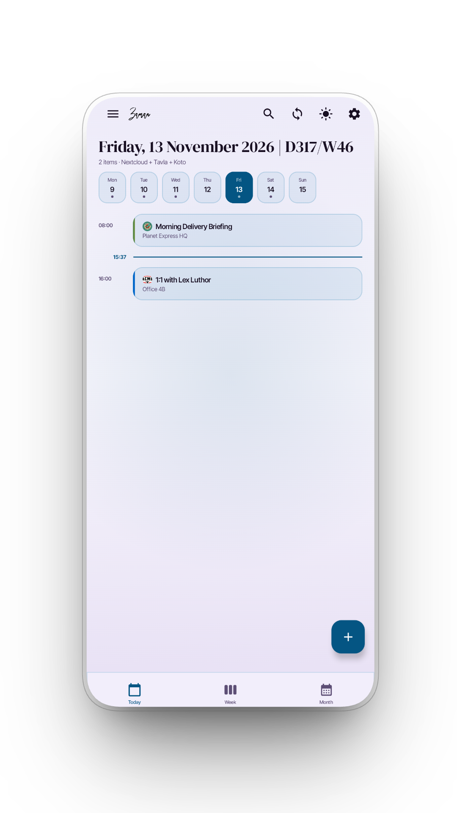
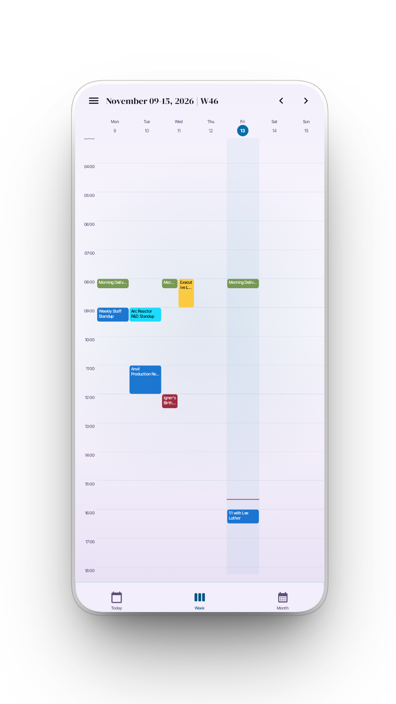
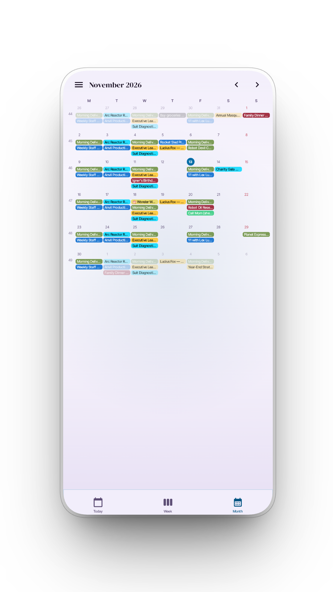
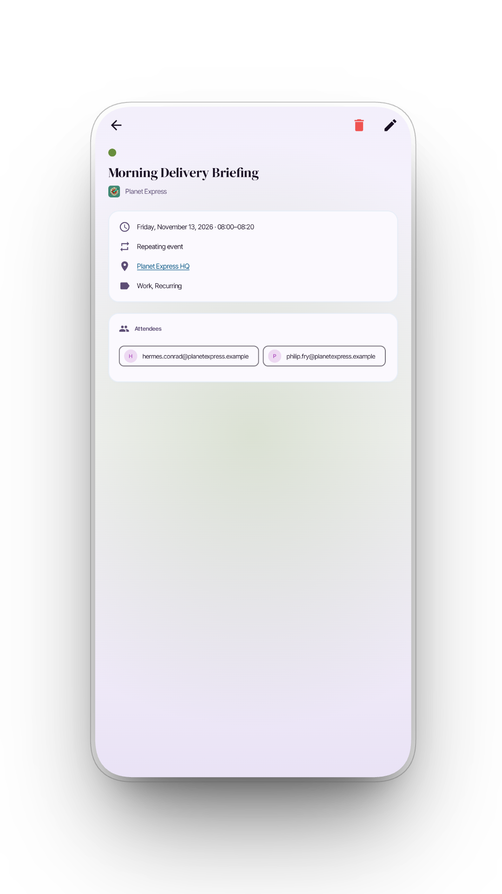
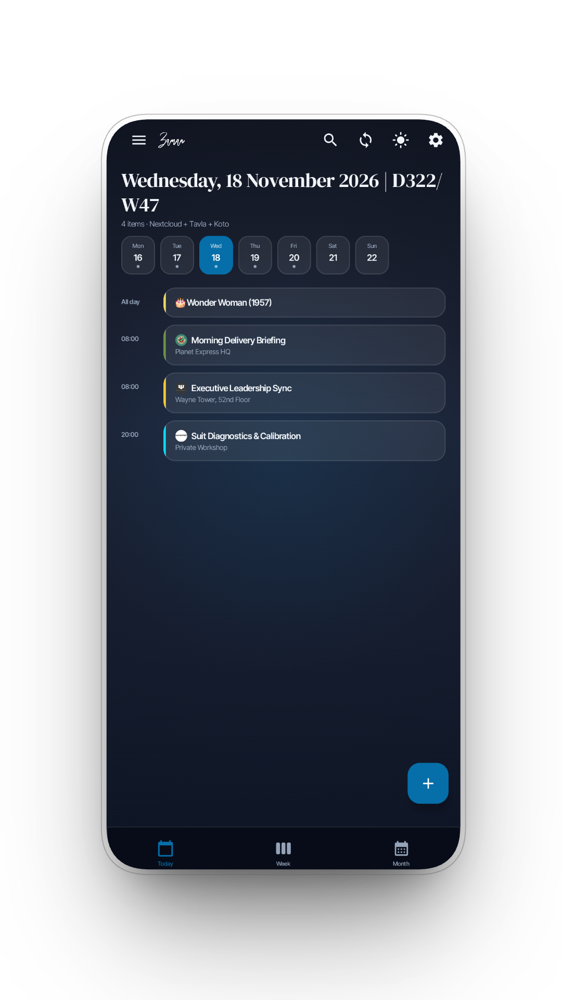
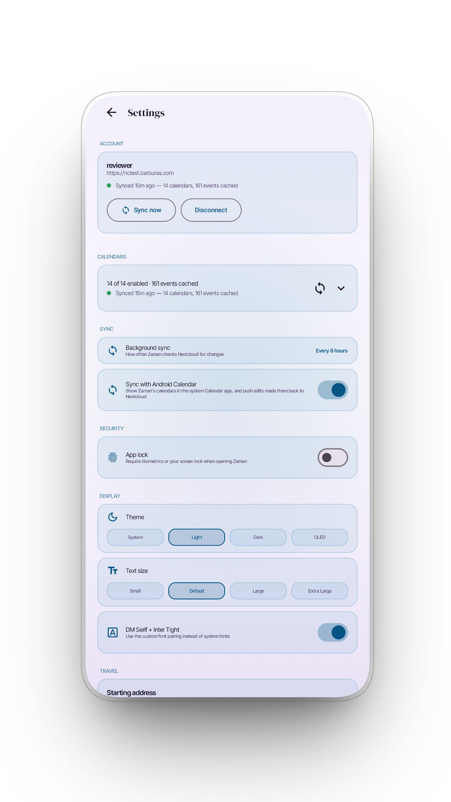

# Zaman — Calendar for Nextcloud

> Your calendars, your server. CalDAV, directly — no DAVx5/ICSx bridge required.


[](https://play.google.com/store/apps/details?id=com.brbrs.zaman)
[](https://android.barburas.com/repo)
[](LICENSE)


---

Zaman is a free, open-source, privacy-first calendar client for Android. Your events, calendars, and reminders live entirely on your own Nextcloud, no third-party servers, no tracking, no ads.

---

## Screenshots

| Today | Week | Month |
|-------|------|-------|
|  |  |  |

| Event Detail | Dark Mode | Settings |
|--------------|-----------|----------|
|  |  |  |

---

## Features

- **Direct CalDAV** — PROPFIND calendar discovery, `calendar-query` / `sync-collection` REPORT, read/write, over OkHttp. No Android `CalendarContract`, no DAVx5/ICSx bridge
- **Today, Week, and Month views** — each designed to stay readable instead of cramped
- **Per-calendar color coding and toggles** — including Nextcloud ICS subscriptions, listed alongside writable calendars
- **Event create / edit / delete** — a real form (title, all-day, start/end, location, notes, calendar picker), with recurring events via RRULE (Daily/Weekly/Monthly/Yearly, plus preserving custom RRULEs written elsewhere)
- **Event reminders** — relative "before start" alarms that round-trip to Nextcloud as a real `VALARM`, surviving a reboot
- **"Protect this time"** — mark an event as a hard block; Zaman warns you before anything gets scheduled over it
- **Attendee linking to Vinci** — tap an attendee to see their name and photo pulled from your Vinci contacts, not just a bare email address
- **Tap-to-navigate** — tap a location to open navigation in whichever app is actually installed, not just one specific provider
- **Single event screen** — date (with year), time, calendar, location, tags, and attendees, tinted with the event's calendar color
- **Koto integration** — Nextcloud Tasks due-dates shown in the agenda (read-only)
- **Tavla integration** — Nextcloud Deck card due-dates shown in the agenda (read-only)
- **Biometric lock** — require fingerprint or face unlock when opening Zaman
- **Light / Dark / OLED themes** — plus adjustable text size, applied throughout the app
- **Local-only mode** — export/import a full backup for devices without Nextcloud
- **Nextcloud sync** — all data syncs to your own Nextcloud via CalDAV; Zaman reads the same account's address book directly over CardDAV for the Vinci link, no Vinci app required on-device

---

## Requirements

- Android 9 (API 28) or higher
- A self-hosted [Nextcloud](https://nextcloud.com) instance

---

## Privacy

Zaman has no backend. All data, calendars, events, reminders, is stored on **your own Nextcloud**. Zaman never connects to any server other than the one you configure. No analytics, no crash reporting, no ads, no tracking of any kind.

Privacy policy: [barburas.com/privacy-policy](https://barburas.com/privacy-policy)

---

## Building from Source

```bash
git clone https://github.com/andreibarburas/zaman-android.git
cd zaman-android
./gradlew assembleDebug
```

Requires Android Studio Ladybug or newer, JDK 17+.

---

## About Author

Hi, I'm [Andrei Barburas](https://barburas.com). By day, I work at the intersection of information management, intelligence gathering, and human cyber risk; designing systems that make sense of complexity and surface what usually stays unseen, drawing on a background in counter-terrorism research and the behavioral patterns behind radicalization and digital vulnerability. I also lecture in Ethics, Communication Management, and Cross-Cultural Management, and write and teach courses on psychology, culture, and critical thinking.

This corner of GitHub is the other side of that same instinct. I build a small collection of free, open-source tools for people who self-host: a suite of [Android Apps](https://github.com/stars/andreibarburas/lists/android-apps) designed around Nextcloud and selfhosters, along with [Home Assistant Apps](https://github.com/andreibarburas/hassio-apps) and a handful of [Wordpress Plugins](https://github.com/andreibarburas/lists/wordpress-plugins).

I started making these because I wanted something the existing options didn't offer; small, focused tools that fit my own self-hosted setup instead of forcing me to compromise. No ads, no tracking, GPLv3 licensed where applicable, and built to work with the tools people already run at home.

## AI Usage

I'm open about the fact that I use AI throughout development. It genuinely helps me move faster and build things I wouldn't otherwise have time for as one person. But AI doesn't replace the actual work; I still spend the evenings figuring out what something should actually do, testing it against real setups and edge cases, and tracking down the inevitable weird bugs. AI is a tool I use, not a shortcut around the thinking.

## Support

If my work saves you time, a small tip means a lot:

- ⭐ **Donate via Bunq (my bank):** [bunq.me/barburasdonations](https://bunq.me/barburasdonations?description=Donation%20from%20Github)
- 🐈‍⬛ **GitHub Sponsors:** [github.com/sponsors/andreibarburas](https://github.com/sponsors/andreibarburas)
- ☕ **Buy me a coffee:** [buymeacoffee.com/barburas](https://buymeacoffee.com/barburas)
- 🌐 **Website:** [barburas.com](https://barburas.com)
- 🐛 **Issues & feature requests:** [open an issue](../../issues)

## Links

- [Play Store](https://play.google.com/store/apps/dev?id=6842866278906089090) [](https://play.google.com/store/apps/dev?id=6842866278906089090)
- [F-Droid Self-Hosted Repo](https://android.barburas.com/repo) [](https://android.barburas.com/repo)
- [r/BarburasLab](https://reddit.com/r/barburaslab) 
- [Privacy Policy](https://barburas.com/privacy-policy/) [](LICENSE)

## Other work on Github

- [Android Apps](https://github.com/stars/andreibarburas/lists/android-apps)
- [Home Assistant Apps](https://github.com/andreibarburas/hassio-apps)
- [Wordpress Plugins](https://github.com/stars/andreibarburas/lists/wordpress-plugins)

## License

All my work is licensed under the [GNU General Public License v3.0](LICENSE).

You are free to use, study, modify, and redistribute this software, provided that any distributed modifications are also licensed under GPL v3 and the source code remains available.

---

*by [andrei BARBURAS](https://barburas.com)* 